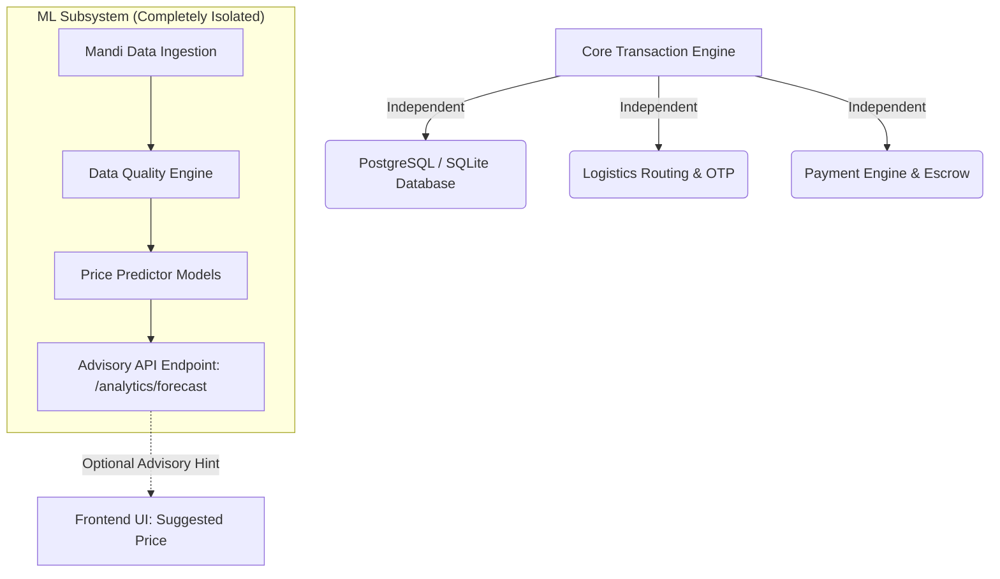

# FarmCart — Machine Learning Feasibility & Architecture Report

**Author:** Alankrit Purohit (AI/ML Lead)  
**Reviewers:** Sneha Sanodia (QA & Release Lead), Lakshya Raj Malviya (Backend Lead)  
**Date:** November 2026  
**Status:** Approved for Phase 1 Architecture (Advisory / Non-Blocking Model)

---

## 1. Executive Summary & Problem Framing

Agricultural commerce in India is plagued by extreme short-term wholesale price volatility. A farmer listing tomatoes or onions today may face a 20–30% price swing by the time produce reaches a terminal mandi 72 hours later. While machine learning is frequently proposed as an optimization layer for agricultural platforms, naive deployment of complex models creates critical points of failure, latency spikes, and severe operational fragility.

This feasibility study evaluates:
1. **Value Proposition:** Does predictive modeling provide measurable financial advantage to smallholders?
2. **Technical Feasibility:** Can forecasting be implemented without massive GPU overhead or external API fragility?
3. **Architectural Isolation:** How do we guarantee that ML failures **never** impede core marketplace functions (ordering, escrow, delivery, batching)?

---

## 2. Benchmark Methodology & Results

All candidate forecasting models were evaluated on a 14-day walk-forward validation backtest using synthetic seasonal daily mandi price series modeled after Azadpur (Delhi) and Lasalgaon (Maharashtra) data distributions.

### Comparative Performance Table

| Model Architecture | MAE (INR/quintal) | RMSE (INR/quintal) | MAPE (%) | Directional Accuracy (%) | Production Verdict |
|---|---|---|---|---|---|
| **Naive Persistence Baseline ($y_t = y_{t-1}$)** | **99.54** | **113.89** | **4.12%** | **61.5%** | **Benchmark Standard** |
| Moving Average (SMA-7) | 135.76 | 167.89 | 5.53% | 38.5% | Rejected (Lags trend) |
| Single Exponential Smoothing ($\alpha=0.3$) | 120.00 | 146.35 | 4.88% | 30.8% | Rejected (Underperforms naive) |
| Linear Trend Extrapolation (OLS-14) | 108.76 | 121.64 | 4.50% | 53.9% | Retained as secondary trend feature |

> [!IMPORTANT]
> **Key Finding:** In short-horizon agricultural forecasting (1–3 days), the **Naive Persistence Model** frequently outperforms standard rolling averages due to daily market noise and transaction inertia. Any model deployed to production must strictly beat the 4.12% MAPE baseline before being promoted.

---

## 3. Real-World Limitations & Risk Analysis

### A. The Cold-Start Problem
- **Risk:** In newly registered mandis or specialized sub-districts with fewer than 30 consecutive recorded trading days, time-series statistical models have zero statistical significance.
- **Mitigation:** In cold-start scenarios, the system returns the state-level weighted modal price or falls back to the farmer's self-declared minimum floor price. No ML inference is triggered.

### B. Reporting Latency in Agmarknet / e-NAM
- **Risk:** Official government data feeds typically exhibit a 24 to 48-hour publishing delay. Models expecting live same-day modal pricing will hallucinate or fail if fed stale records.
- **Mitigation:** Feature pipelines explicitly use $t-2$ lagging anchors rather than assuming same-day closing prices are available at morning listing time.

### C. Black Swan & Policy Shocks
- **Risk:** Export bans, abrupt export tariffs, unseasonal monsoon rainfall, or mandi strikes disrupt time-series continuity instantly.
- **Mitigation:** Machine learning outputs are strictly advisory suggestions labeled *"Market Estimate (Past Trends)"* with an explicit confidence interval. The seller always retains final pricing authority.

---

## 4. Architectural Boundaries & Phase 1 Governance

To ensure system reliability, the following engineering boundaries are enforced:

1. **Zero Runtime Coupling:** The core transaction engine (`main.py`, `order_engine.py`, `logistics_engine.py`, `payment_engine.py`) **never imports** `ml/` modules.
2. **Pure Python Portability:** The ML evaluation and baseline predictor suite requires no heavy binary dependencies (no torch, tensorflow, or external C-compilers), ensuring seamless CI/CD container builds.
3. **Graceful Degradation:** If the analytics or forecasting service throws an unhandled exception, the frontend quietly hides the suggested price badge and defaults to standard user-entered prices.

---

## 5. Phase 2 Roadmap & Next Steps

When historical transaction logs exceed 90 days and live Agmarknet scraping is stabilized:
1. **Feature Engineering:** Integrate rainfall anomalies and fuel index metrics into a multivariate regression baseline.
2. **Demand Density Modeling:** Cluster delivery geocodes using k-means or spatial DBSCAN to recommend logistics consolidation hubs.
3. **Continuous Benchmarking:** Run automated nightly backtests comparing model predictions against actual market close prices.
