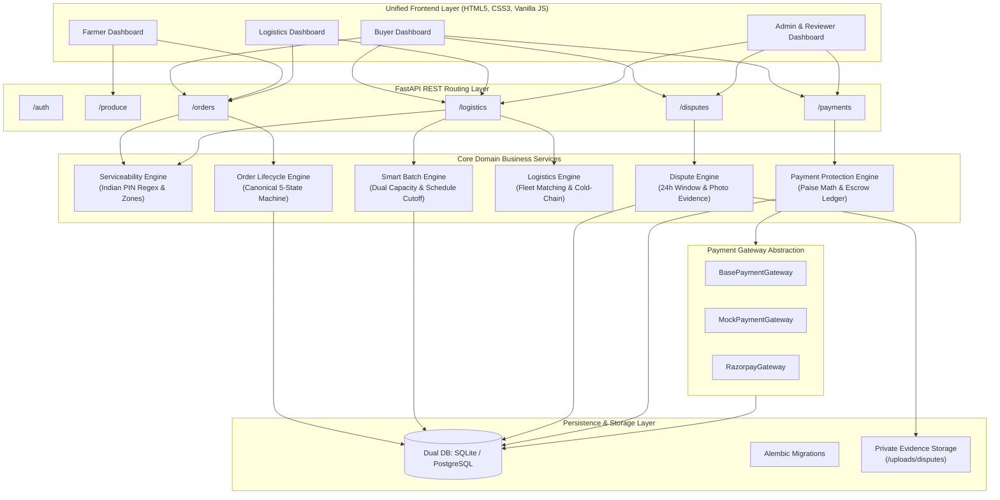
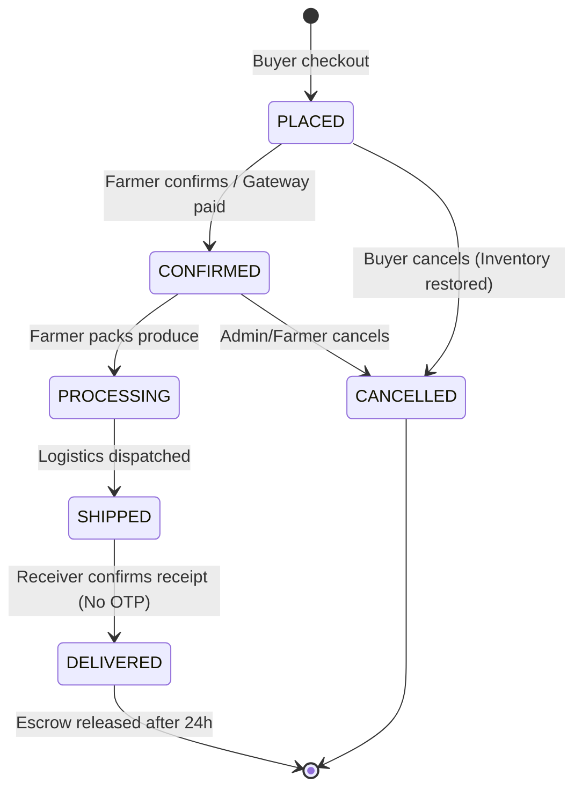
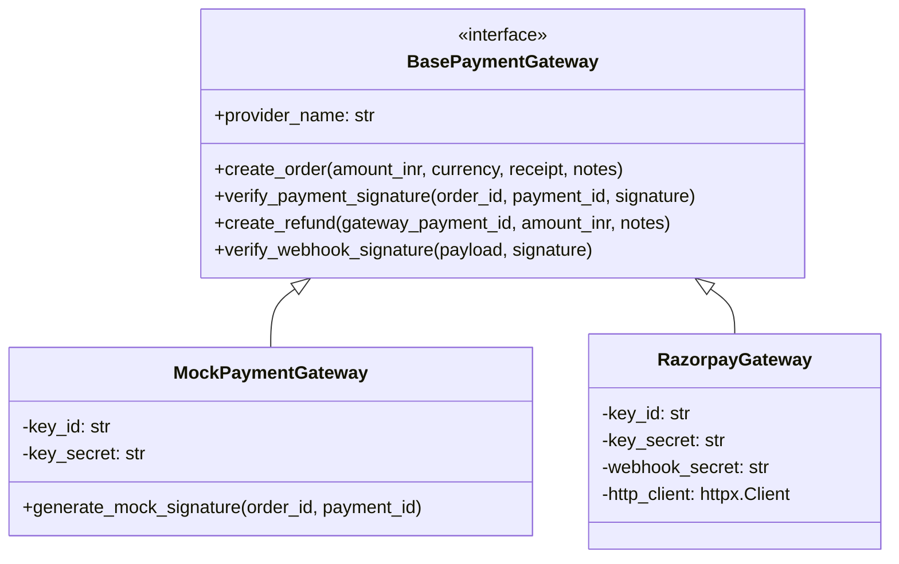

# FarmCart Phase 2: System Architecture Specification

**Project:** FarmCart Direct Farm-to-Consumer Marketplace  
**Team:** Agile 11  
**Architecture Scope:** Phase 2 Master Implementation  
**Status:** Verified & Deployed  

---

## 1. Architectural Overview & Design Principles

FarmCart Phase 2 extends the foundational direct-sales architecture of Phase 1 to support nationwide geographic operations across India, dual-capacity automated batch logistics, receiver-driven delivery confirmation without OTP, evidence-backed customer dispute management, and pluggable digital payment gateway integrations with an immutable double-entry financial ledger.

---

## 2. Nationwide Geographic Serviceability Architecture

The nationwide serviceability subsystem decouples basic geographic address handling from active delivery capacity:
1. **Indian Address Standards:** Addresses accept line, locality, city, district, state, and a mandatory 6-digit PIN code.
2. **PIN Code Validation:** Strict regex enforcement `^[1-9][0-9]{5}$` rejects leading zeros, non-numeric characters, and invalid lengths without forcing dependency on paid external geocoding APIs.
3. **Delivery Zones (`DeliveryZone`):** Configured zones encapsulate covered PIN codes, dispatch buffer times (default 60 min), preparation buffers (default 4 hours), and configurable minimum weight thresholds.
4. **Delivery Modes:**
   - `home_delivery`: Last-mile delivery directly to the customer's specified doorstep.
   - `shared_drop_point`: Consolidated delivery to pre-registered community hubs, metro stations, or local collection centers.

---

## 3. Automatic Delivery-Batch Engine

Orders are clustered automatically based on geographic area/zone, delivery date, time slot, and delivery mode:

### 3.1 Dual Capacity Constraints
Every delivery batch strictly enforces two concurrent capacity limits:
1. **Weight Constraint:** `batch.total_weight_kg + order_weight <= batch.max_weight_kg` (default 500 kg or zone-configured).
2. **Order Count Constraint:** `batch.order_count + 1 <= batch.max_orders` (default 50 orders or zone-configured).

When adding an order would breach either constraint, the system atomically seals the full batch and creates a new batch.

### 3.2 Schedule-Driven Cutoff Formulation
Rather than waiting indefinitely, each delivery slot has a deterministic cutoff calculation:
$$\text{Batch Cutoff} = \text{Slot Start Time} - \text{Preparation Buffer} - \text{Dispatch Buffer}$$

- Morning slot: 09:00 UTC (Cutoff at 06:30 with 2h prep + 30m dispatch).
- Afternoon slot: 14:00 UTC.
- Evening slot: 19:00 UTC.

Batches passing cutoff are automatically evaluated by `evaluate_cutoff_batches()`:
- If `total_weight_kg >= min_threshold_kg`: Batch is auto-dispatched to logistics.
- If `total_weight_kg < min_threshold_kg`: Batch is marked `review_required` for administrative review.

### 3.3 Delivery Mode Isolation
Home delivery orders and Shared Drop Point orders are strictly segregated. Shared Drop Point batches only group orders destined for the identical drop point ID.

---

## 4. Canonical 5-State Order Lifecycle

The system enforces a standardized, state-machine driven order progression:

Every state change is recorded in the `order_status_history` table with timestamps, actor ID, role, and justification notes.

---

## 5. Receiver Confirmation Without OTP

Phase 2 replaces the friction of OTP delivery verification with authenticated receiver receipt:
1. When an order is in transit / shipped, the authenticated receiver (buyer) clicks **"Confirm Delivery Receipt"**.
2. The endpoint `POST /logistics/deliveries/{id}/confirm-receipt` validates that the caller is the designated buyer (or platform admin).
3. The delivery is marked `delivered`, `receiver_confirmed = True`, and `receiver_confirmed_at` is stamped.
4. Receipt confirmation automatically starts the **24-hour buyer confirmation & dispute window**.

---

## 6. Dispute Management Subsystem

To protect buyers against transit damage or spoilage:
1. **24-Hour Strict Window:** A dispute can only be filed within 24 hours of delivery.
2. **Evidence Collection:** Supports JPEG, PNG, and WebP photo uploads up to 5MB, stored in private application directories outside public web roots.
3. **Automated Payment Protection:** Filing a dispute immediately places associated escrow payments on hold (`is_on_hold = True`). Payout release is blocked.
4. **Reviewer Decisioning:** Designated reviewers/admins review photo evidence and select one of three terminal resolutions:
   - `REFUND`: Issues full refund to buyer.
   - `RELEASE`: Dismisses dispute and authorizes payment release to farmer.
   - `REJECTED`: Rejects claim as invalid or fraudulent.

---

## 7. Pluggable Payment Gateway & Double-Entry Ledger

### Financial Integrity Principles
- **Paise Precision:** All internal financial allocations are computed in integer paise ($₹1 = 100 \text{ paise}$) to eliminate IEEE 754 floating point rounding drift.
- **Double-Entry Audit Log (`payment_ledger_entries`):** Every financial event (Initiation, Capture, Escrow Hold, Release, Refund) appends an immutable ledger entry with previous and new states, timestamp, and gateway reference.
- **Escrow Settlement Window:** Payouts to farmers and logistics partners are only released when the 24-hour confirmation window expires with no active disputes.

