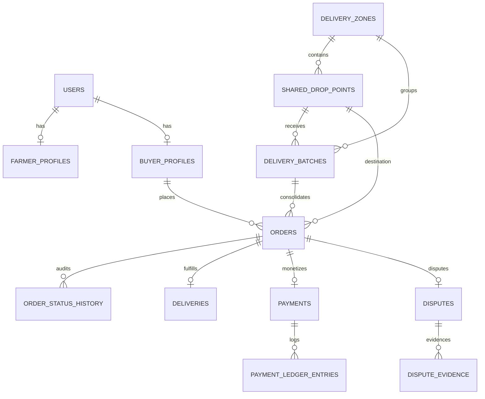

# FarmCart Phase 2: Database Schema & Migration Specification

**Project:** FarmCart Direct Farm-to-Consumer Marketplace  
**Team:** Agile 11  
**Dual Database Compatibility:** SQLite (Local Dev) & PostgreSQL 16 (Production)  

---

## 1. Schema Overview

Phase 2 introduces 6 new database tables and extends 6 existing core tables to support nationwide Indian address models, dual-capacity delivery batches, receiver delivery confirmation, dispute evidence, and double-entry financial ledgering.



---

## 2. New Database Tables

### 2.1 `delivery_zones`
Defines operational geographic boundaries across India.
- `id`: String (UUID PK)
- `name`: String (Unique, Indexed)
- `state`: String
- `district`: String
- `city`: String (Optional)
- `serviceable_pincodes`: Text / JSON (Array of validated 6-digit PIN codes)
- `min_batch_threshold_kg`: Float (Default 25.0)
- `max_batch_weight_kg`: Float (Default 1000.0)
- `max_batch_orders`: Integer (Default 50)
- `preparation_buffer_hours`: Float (Default 4.0)
- `dispatch_buffer_hours`: Float (Default 2.0)
- `allows_home_delivery`: Boolean (Default True)
- `allows_drop_point`: Boolean (Default True)
- `is_active`: Boolean (Default True)
- `created_at`, `updated_at`: DateTime

### 2.2 `shared_drop_points`
Physical community hubs and pickup depots for consolidated dropoff.
- `id`: String (UUID PK)
- `zone_id`: String (FK -> `delivery_zones.id`)
- `name`: String
- `address_line`: String
- `locality`: String (Optional)
- `city`: String
- `district`: String
- `state`: String
- `pincode`: String (6-digit Indian PIN)
- `operating_hours`: String (Default "08:00 - 20:00")
- `capacity_orders`: Integer (Default 100)
- `contact_phone`: String (Optional)
- `is_active`: Boolean (Default True)
- `latitude`, `longitude`: Float (Optional)
- `created_at`: DateTime

### 2.3 `order_status_history`
Immutable chronological audit log for all order status changes.
- `id`: String (UUID PK)
- `order_id`: String (FK -> `orders.id`)
- `previous_status`: String (Optional)
- `new_status`: String (Canonical state)
- `actor_id`: String (FK -> `users.id`)
- `actor_role`: String
- `reason`: Text (Optional)
- `created_at`: DateTime

### 2.4 `disputes`
Customer dispute records filed within 24 hours of delivery.
- `id`: String (UUID PK)
- `order_id`: String (FK -> `orders.id`, Unique)
- `buyer_id`: String (FK -> `buyer_profiles.id`)
- `reason`: String (Enum: `QUALITY_ISSUE`, `DAMAGED_PRODUCE`, `MISSING_ITEMS`, `WRONG_ITEMS`, `LATE_DELIVERY`, `OTHER`)
- `description`: Text
- `status`: String (Default "OPEN": `OPEN`, `UNDER_REVIEW`, `RESOLVED_REFUND`, `RESOLVED_RELEASE`, `REJECTED`, `CANCELLED`)
- `resolution_decision`: String (Optional: `REFUND`, `RELEASE`, `REJECTED`)
- `resolution_notes`: Text (Optional)
- `resolved_by_id`: String (FK -> `users.id`, Optional)
- `resolved_at`: DateTime (Optional)
- `created_at`, `updated_at`: DateTime

### 2.5 `dispute_evidence`
Photographic evidence attachments for filed disputes.
- `id`: String (UUID PK)
- `dispute_id`: String (FK -> `disputes.id`)
- `file_path`: String (Private disk path)
- `file_name`: String (Original uploaded name)
- `mime_type`: String (`image/jpeg`, `image/png`, `image/webp`)
- `file_size_bytes`: Integer (Max 5MB)
- `uploaded_at`: DateTime

### 2.6 `payment_ledger_entries`
Double-entry append-only financial audit log.
- `id`: String (UUID PK)
- `payment_id`: String (FK -> `payments.id`)
- `order_id`: String (FK -> `orders.id`)
- `previous_status`: String (Optional)
- `new_status`: String (PaymentStatus value)
- `amount`: Float (₹)
- `amount_paise`: Integer (Precise integer paise)
- `currency`: String (Default "INR")
- `actor_id`: String (Optional)
- `actor_type`: String (`buyer`, `farmer`, `logistics`, `admin`, `gateway`, `system`)
- `reason`: String
- `gateway_reference`: String (Optional)
- `created_at`: DateTime

---

## 3. Schema Extensions on Existing Tables

| Existing Table | Added Columns | Type | Purpose |
|---|---|---|---|
| `orders` | `delivery_mode` | String | `home_delivery` vs `shared_drop_point` |
| `orders` | `address_line`, `pincode`, `city`, `district`, `state` | String | Structured Indian address fields |
| `orders` | `zone_id` | String FK | Delivery zone association |
| `orders` | `drop_point_id` | String FK | Shared drop point association |
| `orders` | `confirmed_at`, `processing_at`, `shipped_at`, `delivered_at` | DateTime | Canonical lifecycle milestone timestamps |
| `delivery_batches` | `zone_id` | String FK | Associated delivery zone |
| `delivery_batches` | `delivery_mode` | String | Mode isolation (`home_delivery` / `shared_drop_point`) |
| `delivery_batches` | `drop_point_id` | String FK | Drop point isolation |
| `delivery_batches` | `cutoff_time` | DateTime | Schedule cutoff timestamp |
| `delivery_batches` | `min_threshold_kg` | Float | Configurable minimum threshold |
| `delivery_batches` | `max_weight_kg`, `max_orders` | Float / Int | Dual capacity bounds |
| `delivery_batches` | `current_order_count` | Integer | Atomic order count meter |
| `deliveries` | `receiver_confirmed` | Boolean | Receiver receipt without OTP flag |
| `deliveries` | `confirmed_by_id` | String FK | Receiver user ID |
| `deliveries` | `confirmed_at` | DateTime | Receiver confirmation timestamp |
| `deliveries` | `delivery_mode`, `drop_point_id` | String | Fulfillment type and hub |
| `payments` | `amount_paise`, `platform_fee_paise`, `farmer_share_paise`, `logistics_share_paise` | Integer | Exact integer paise precision |
| `payments` | `gateway_provider`, `gateway_order_id`, `gateway_payment_id`, `gateway_signature` | String | Payment gateway transaction tracking |
| `payments` | `is_on_hold`, `hold_reason` | Bool / String | Dispute payment protection hold |
| `payments` | `buyer_confirmation_deadline` | DateTime | 24-hour buyer confirmation deadline |

---

## 4. Alembic Migration & Dual Compatibility

Database migrations are managed via **Alembic** (`backend/alembic/`):
- **SQLite Support:** Configured with `render_as_batch=True` to support SQLite's table recreation pattern for table alterations without schema corruption.
- **PostgreSQL Support:** Standard DDL statements with transactional DDL support.
- **Migration Execution:**
  ```bash
  cd backend
  alembic upgrade head
  ```
- **Current Revision:** `22f82a866cc9` (head).

