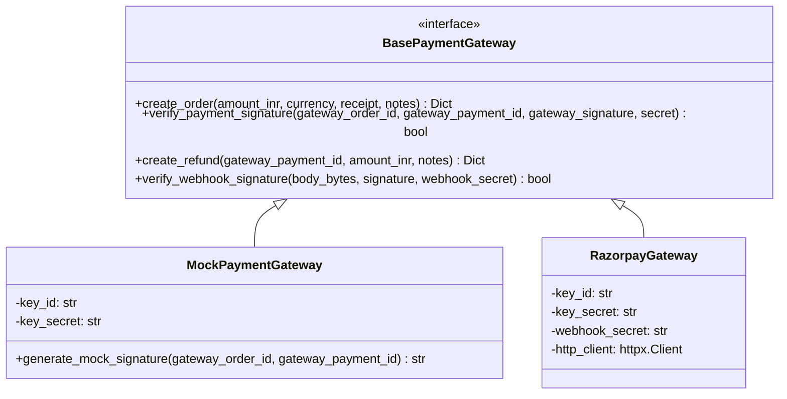

# FarmCart Phase 2: Payment Gateway & Escrow Settlement Specification

**Project:** FarmCart Direct Farm-to-Consumer Marketplace  
**Team:** Agile 11  
**Status:** Implemented & Verified  

---

## 1. Gateway Abstraction Architecture

FarmCart Phase 2 implements a provider-agnostic payment gateway architecture:

Gateway instances are instantiated dynamically via `get_payment_gateway(provider_name)` based on the `PAYMENT_PROVIDER` environment variable or database record.

---

## 2. Supported Payment Providers

### 2.1 `MockPaymentGateway` (Offline Test & Local Development)
- **Zero Third-Party Dependency:** Runs entirely in-process without external network requests.
- **Deterministic Simulation:** Generates synthetic order IDs (`mock_order_<hex>`) and verifiable HMAC-SHA256 signatures.
- **Used by Test Suite:** Powers automated tests and integration workflows safely without credentials.

### 2.2 `RazorpayGateway` (Production & Sandbox Integration)
- **Standard HTTP Architecture:** Uses standard `httpx.Client` to interact with Razorpay's REST API (`https://api.razorpay.com/v1`).
- **Endpoints Implemented:**
  - `POST /v1/orders`: Creates checkout order with integer paise amount.
  - `POST /v1/payments/{id}/refund`: Triggers partial or full merchant refund.
- **HMAC Signature Verification:** Verifies payment authenticity via:
  $$\text{Expected Signature} = \text{HMAC-SHA256}(\text{key\_secret}, \text{gateway\_order\_id} \parallel "|" \parallel \text{gateway\_payment\_id})$$
- **Live Safety Gate:** In accordance with prompt requirements, `payment_live_enabled` defaults to `False`. Real external funds disbursement requires explicit administrative enablement and onboarded merchant credentials.

---

## 3. Financial Integrity & Integer Paise Mathematics

To eliminate floating-point rounding inaccuracies:
1. Every monetary transaction is computed and stored in **integer paise** ($1 \text{ INR} = 100 \text{ paise}$):
   $$\text{amount\_paise} = \text{int}(\text{round}(\text{amount\_inr} \times 100))$$
2. **3-Way Platform Allocation:**
   $$\text{platform\_fee\_paise} = \text{int}(\text{round}(\text{amount\_paise} \times \frac{\text{PLATFORM\_FEE\_PERCENT}}{100}))$$
   $$\text{farmer\_share\_paise} = \text{amount\_paise} - \text{platform\_fee\_paise}$$
   $$\text{farmer\_share} + \text{logistics\_share} + \text{platform\_fee} \equiv \text{total\_amount}$$
3. All allocations are audited in append-only `PaymentLedgerEntry` records before and after each status transition.

---

## 4. Escrow Protection & 24-Hour Settlement Window

1. **Payment Capture:** Upon successful client signature verification, payment status becomes `PAID`. Funds are held in platform escrow.
2. **Delivery Receipt Confirmation:** Receiver confirms delivery receipt without OTP. This timestamps `receiver_confirmed_at` and sets:
   $$\text{buyer\_confirmation\_deadline} = \text{now\_utc} + 24\text{ hours}$$
3. **Dispute Invalidation / Hold:** If the buyer files a dispute within 24 hours, `is_on_hold` is set to `True`, status transitions to `ON_HOLD`, and payout release is immediately frozen.
4. **Payout Settlement:** When the 24-hour window elapses without an active dispute, `evaluate_payment_release_eligibility()` returns `True`, allowing `settle_payout()` to execute the 3-way disbursement to farmer, logistics partner, and platform accounts.

