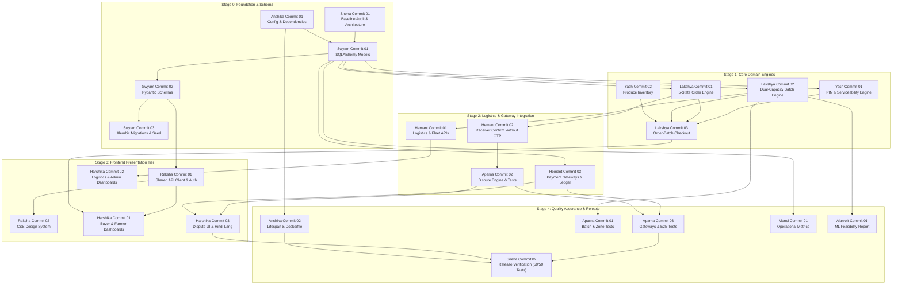

# FarmCart Phase 2 — Commit Dependency Map

This document visualizes the technical prerequisite graph across the **25 commit packages** of the 11 team members.

---

## 1. Technical Dependency Diagram (Mermaid)

---

## 2. Dependency Matrix Summary

1. **Swyam Shukla (Database Lead):** Must establish models (`Commit 01`) and schemas (`Commit 02`) before any backend service or frontend API client can serialize data.
2. **Yash Goyal (Serviceability):** Must finalize Indian PIN code validation (`Commit 01`) before Lakshya's order checkout (`Commit 03`) can validate delivery addresses.
3. **Lakshya Raj Malviya (Order & Batch Engines):** Must implement state transitions (`Commit 01`) and batch logic (`Commit 02`) before logistics dispatch or order checkout can be finalized.
4. **Hemant Yadav (Logistics & Payments):** Relies on order state transitions for receiver delivery confirmation (`Commit 02`) and Swyam's financial schema for payment gateways (`Commit 03`).
5. **Raksha Pandey (Shared Frontend):** Must deliver `apiFetch` in `api.js` before Harshika Singh can wire up buyer, farmer, and admin dashboards.
6. **Harshika Singh (Dashboards):** Directly consumes endpoints from Lakshya, Hemant, and Aparna.
7. **Aparna Jha (Testing):** Executes verification suites validating the integration of all backend and UI workflows.
8. **Sneha Sanodia (Release Readiness):** Validates the entire application once all 50 automated tests pass and certifies production release.
